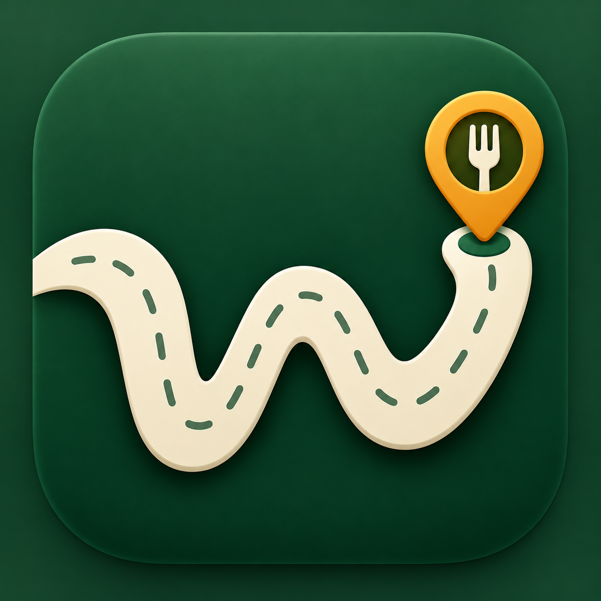
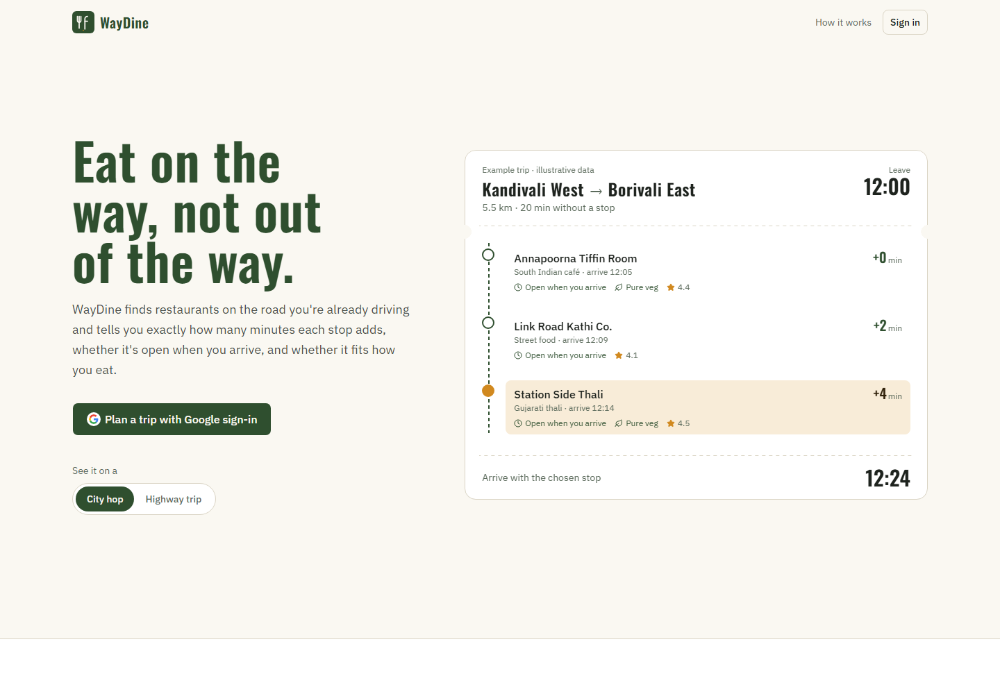
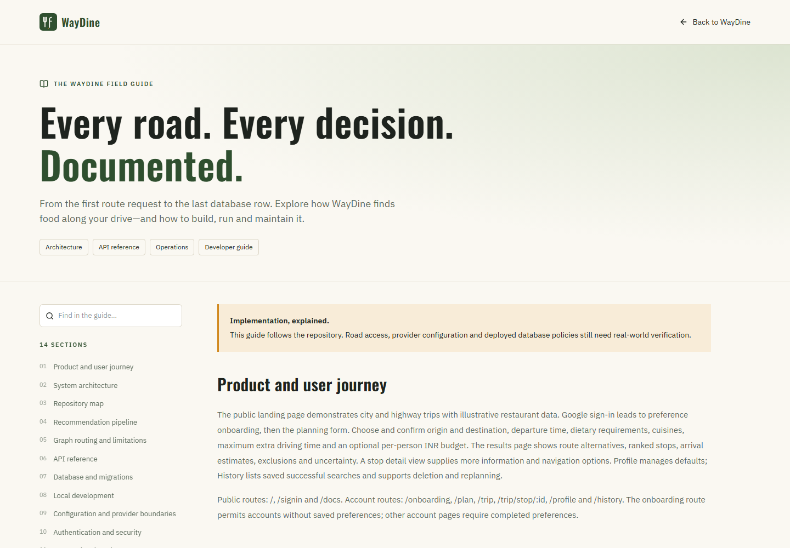
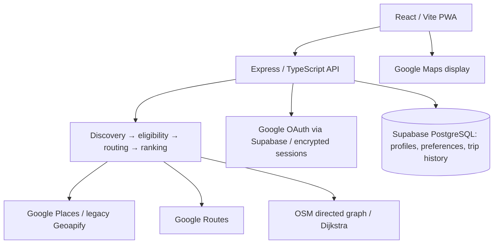

# WayDine

<p align="center">
  
</p>

**Eat on the way, not out of the way.** Route-aware restaurant discovery with explained detours, arrival-time checks, dietary preferences and saved trip plans.

[Complete documentation](docs/PROJECT_GUIDE.md) · **In-app guide: `/docs`** · [Authentication](docs/GOOGLE_AUTH.md) · [Google Places](docs/GOOGLE_PLACES.md) · [Trip history](docs/TRIP_HISTORY.md)

## Product preview






The screenshots show the actual public UI. Landing-page restaurant examples are illustrative; the GIF cycles through public product and documentation views, without live restaurant requests. The generated brand icon is stored in `docs/assets/waydine-icon.png`.

## Architecture



The public `/docs` page and [project guide](docs/PROJECT_GUIDE.md) share one source. They cover the user journey, repository modules, recommendation stages and ranking weights, graph fallback, API endpoints, database migrations, configuration, security, testing and deployment. Account setup requires migrations 004–006; the optional analytics schema is separate from current provider-based discovery.

## Verification

```sh
# backend/
npm run typecheck
npm test
npm run build
# frontend/
npm run lint
npx vitest run
npm run build
```

Automated tests use mocked providers. Obtain explicit approval before any live Google Places request or bounded test batch. For production, configure SPA fallback for `/docs` and other frontend routes while forwarding `/api` to Express.

Eat on the way, not out of the way. Finds restaurants actually on your driving
route — real road distance, direction of travel, and meal timing — instead of
anything just nearby.

Full build plan: [WayDine-Build-Plan.pdf](WayDine-Build-Plan.pdf) (tech stack, schema, pipeline, execution plan).

## Google sign-in (backend)

Google OAuth, encrypted server-side sessions, and user profiles are implemented
through Supabase. Setup, migration, API endpoints, and manual verification:
[Google authentication guide](docs/GOOGLE_AUTH.md).
Authentication is opt-in (`AUTH_ENABLED=true`) after configuration and is
required for Google restaurant recommendations.

## Google Places (backend, opt-in)

The backend has separate, authenticated Google restaurant/detail endpoints with
200 m corridor filtering, bounded enrichment, and daily/monthly request limits.
They are disabled by default. The frontend uses the authenticated Google
recommendation endpoint when enabled.
See [Google Places setup and testing rules](docs/GOOGLE_PLACES.md).
Obtain user approval before any live Google Places test; automated tests use mocks.

## Google map display (optional)

Enable the Maps JavaScript API in Google Cloud and add a browser-restricted key
as `VITE_GOOGLE_MAPS_API_KEY` in `frontend/.env`, then restart the frontend.
The map uses Google Maps; without the key the map is unavailable.
Restrict the browser key to your site's HTTP referrers and the Maps JavaScript
API. Map loads have their own usage and billing limits. Enable the Routes API
and set `GOOGLE_ROUTES_API_KEY` in `backend/.env` using a server-restricted key.
The backend uses Google Routes for routing and route matrix calculations, with
daily limits controlled by `GOOGLE_ROUTES_PER_DAY` and
`GOOGLE_ROUTE_MATRIX_ELEMENTS_PER_DAY`. Side-of-road requests may be billed at
a higher rate; review the Google Cloud quotas and pricing. The Google Places
integration requires Google sign-in and `GOOGLE_PLACES_ENABLED=true`.

## Saved user preferences (backend)

Google-authenticated accounts can read, update and reset their dietary, cuisine,
detour and food-budget defaults. Apply migration 005 after migration 004.
See [user preferences setup and API](docs/USER_PREFERENCES.md).

## User trip history

Signed-in users can open **History** or their profile's **Recent trips** to see
previous successful searches. Apply `backend/sql/006_trip_history.sql` after
migrations 004 and 005. No additional provider keys are needed.
See [trip history setup and behavior](docs/TRIP_HISTORY.md).

## Structure

```
backend/   Express + TypeScript API (/api/recommend, /api/restaurants, /api/health)
frontend/  React + Vite + TypeScript PWA (Tailwind, shadcn/ui, Google Maps)
```

## Setup

1. **Maps and routing**: configure Google Maps and Google Routes as described
   above. Geoapify is used by the existing place search and restaurant
   discovery endpoints; Mapbox search is disabled for the Google map.
2. **Supabase**: required for Google authentication, saved preferences and trip
   history (migrations 004–006). Optional analytics use `search_history`. Create a project
   and run `backend/sql/001_schema.sql` in the SQL editor for the
   `search_history` table. (`002_candidates_rpc.sql` and `003_seed.sql` are
   leftover from an earlier curated-DB design — see "Restaurant data source"
   below — and aren't needed.)
3. Copy `backend/.env.example` → `backend/.env` and `frontend/.env.example` →
   `frontend/.env`, fill in both from the values above. Never commit either `.env`.
4. Install and run:
   ```bash
   cd backend && npm install && npm run dev    # http://localhost:4000
   cd frontend && npm install && npm run dev   # http://localhost:5173
   ```

## Restaurant data source

The frontend uses Google Places for restaurants and Geoapify for location
search. Data such as dietary options and opening hours can be
missing; the backend reports uncertainty rather than assuming it is available.

## Recommendation pipeline (`/api/recommend`)

An experimental OSM directed-graph and Dijkstra core lives in `backend/src/graph`.
It accepts supplied OSM JSON, estimates road weights, snaps points to segments,
and handles supported node-based turn restrictions. The **Show WayDine graph
route** control plots its calculated route in blue on the Google map after
the start and destination are selected, without a restaurant search.
After a recommendation search, selecting a stop allows a graph route via it.
This is a separate preview: recommendation ranking, arrival times and the other
route lines still use Google routing. It is not yet connected to recommendations.
It does not fetch OSM data, guarantee access, handle all
restrictions, or fetch traffic data. The graph can apply fresh, direction-specific
traffic speeds or closures supplied by an adapter; missing or stale observations
fall back to estimated speeds and the route reports the distance covered by each.
The snapshot is a current estimate, not a forecast for future departures.
Integration requires road extract
coverage, safe snapping, performance work, and validation; graph detour and
baseline costs must use the same graph and weight model.

To enable the preview, export an Overpass JSON extract with road ways, referenced
nodes and turn restriction relations for the complete area you want to test.
Set `OSM_GRAPH_PATH` in `backend/.env` to the local JSON file and restart the
backend. Files are limited to 30 MB and 200,000 nodes. This initial preview is
for planning only: no live traffic is connected, graph snapping and restrictions
may be incomplete, and Google navigation may choose a different route. Display
the OpenStreetMap attribution included with the route. Do not use the preview
for live navigation.

Alternatively, set `OSM_GRAPH_SOURCE=overpass` to request OSM road data when
the user asks for a graph preview. One query covers a 3 km corridor around the
straight line between the chosen trip endpoints (not Google's route); restaurant
coordinates are snapped locally and are not sent to Overpass. There is no retry.
The request is limited to 200 km, 30 MB and 200,000 nodes, and may fail or omit
valid detours outside that corridor. Public Overpass availability is not guaranteed.
Set `OSM_GRAPH_SOURCE=file` to use the configured local extract instead.

For a small Mira Road–Borivali test extract, run the following in
[Overpass Turbo](https://overpass-turbo.eu/) and use **Export → raw data → download**:

```overpass
[out:json][timeout:90];
way[highway](19.19,72.80,19.32,72.95)->.roads;
(.roads; rel(bw.roads)[type=restriction];);
(._; >;);
out body;
```

Save the result as `backend/.data/osm-demo.json`, set
`OSM_GRAPH_PATH=.data/osm-demo.json` in `backend/.env`, and restart the backend.
This bounding box does not cover Mumbai–Pune. An extract must cover the whole
route and possible detours; an absent path is not proof that a road is unreachable.

### WayDine graph engine (`ROUTING_ENGINE=graph`)

With `ROUTING_ENGINE=graph` in `backend/.env`, candidate stops are routed by
WayDine's own algorithm instead of Google's matrix and via-route calls:

1. Google Routes supplies only the baseline route (used to find restaurants in the
   200 m corridor and for display). Google Places supplies the restaurants.
2. The road graph comes from `OSM_GRAPH_SOURCE`: `file` (a regional extract such as
   the Mira Road–Borivali one above) or `overpass` (the corridor around the route
   is downloaded once and cached under `GRAPH_CACHE_DIR`; later searches for the
   same corridor are instant). The route must lie inside the extract.
3. The start and destination are snapped onto the graph and each restaurant is
   snapped to the nearest non-motorway road within 75 m. For each, Dijkstra
   (honouring one-ways and turn restrictions) gives
   `shortest(start → stop → destination) − shortest(start → destination)`
   on the same graph.
4. Reversals at through-junctions are counted as U-turns; the via path is compared
   with the baseline path to find backward travel. A stop needing 1 km or more of
   backward travel is excluded; other findings add ranking penalties.
5. Graph times use class-based speeds, so they are scaled to Google's duration for
   your route. The orange route drawn for a stop is the graph path.
6. The top `GRAPH_CROSSCHECK_TOP` stops are re-checked with Google Routes; a large
   disagreement is shown as an uncertainty and never changes the ranking.

If the graph cannot be prepared (extract missing or not covering the route, Overpass
down, endpoints not near a road) the search falls back to Google routing and says so
in `routing.fallbackReason` and the search notes. Road data is OpenStreetMap
(© OpenStreetMap contributors); turn restrictions and access may be incomplete.

1. **Discover** — obtain a Google driving route and search for food places
   along it; the opt-in Google route uses a 200 m point-to-polyline corridor.
2. **Screen and verify** — apply food preferences, estimate detours with Matrix,
   then verify shortlisted stops as complete via-stop driving journeys.
3. **Assess access** — estimate local route side and bearing; compare reported
   U-turn maneuvers, sample for possible backward travel near the stop, and flag
   substantially different via routes. These are evidence, not safety guarantees.
4. **Filter and rank** — exclude confirmed closed, unreachable or over-detour-limit
   stops; rank by added driving time plus penalties for uncertainty, likely
   additional U-turns and possible backward travel. Meal labels use arrival time.

Excluded candidates are returned with reasons (`excluded[]`), not silently
dropped — that's what powers the no-results state honestly.
