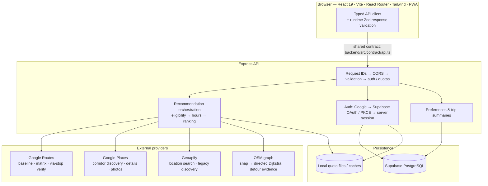
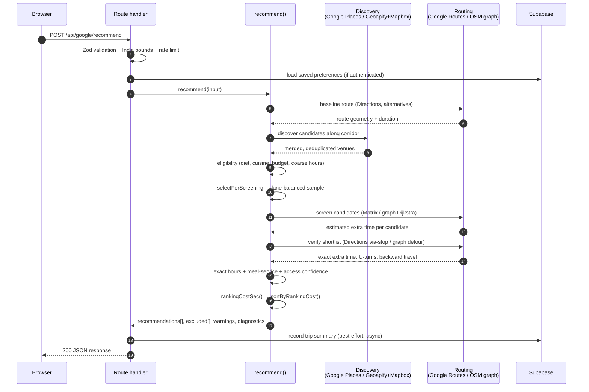
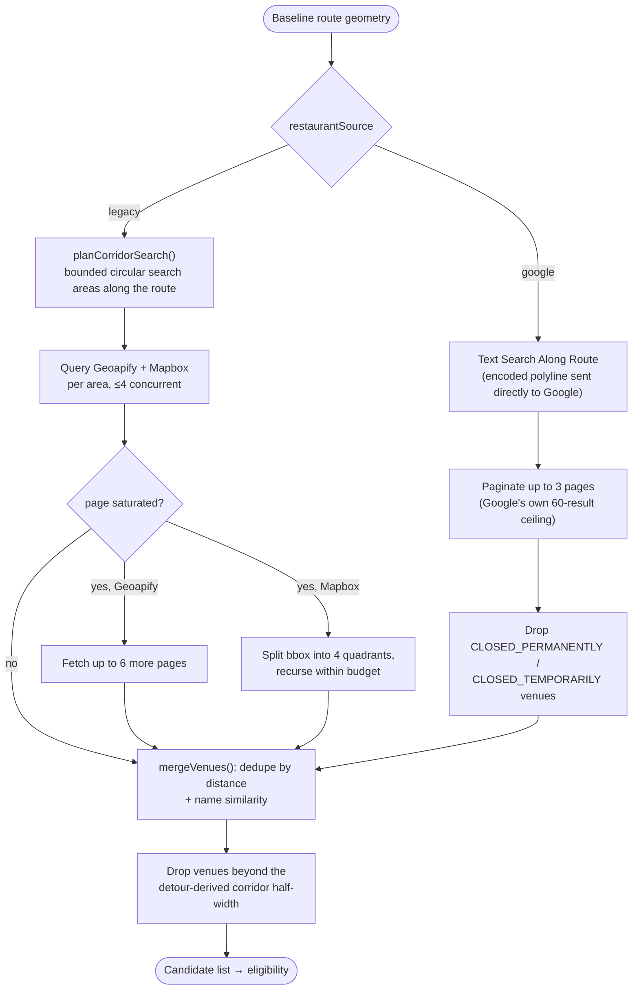
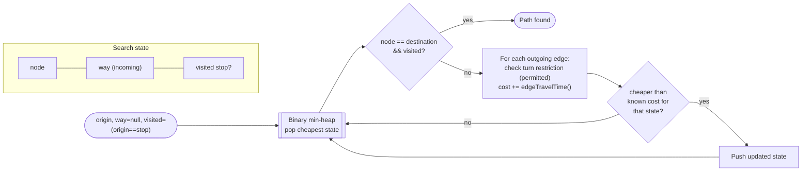
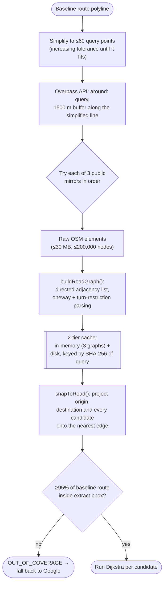
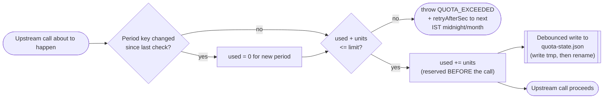
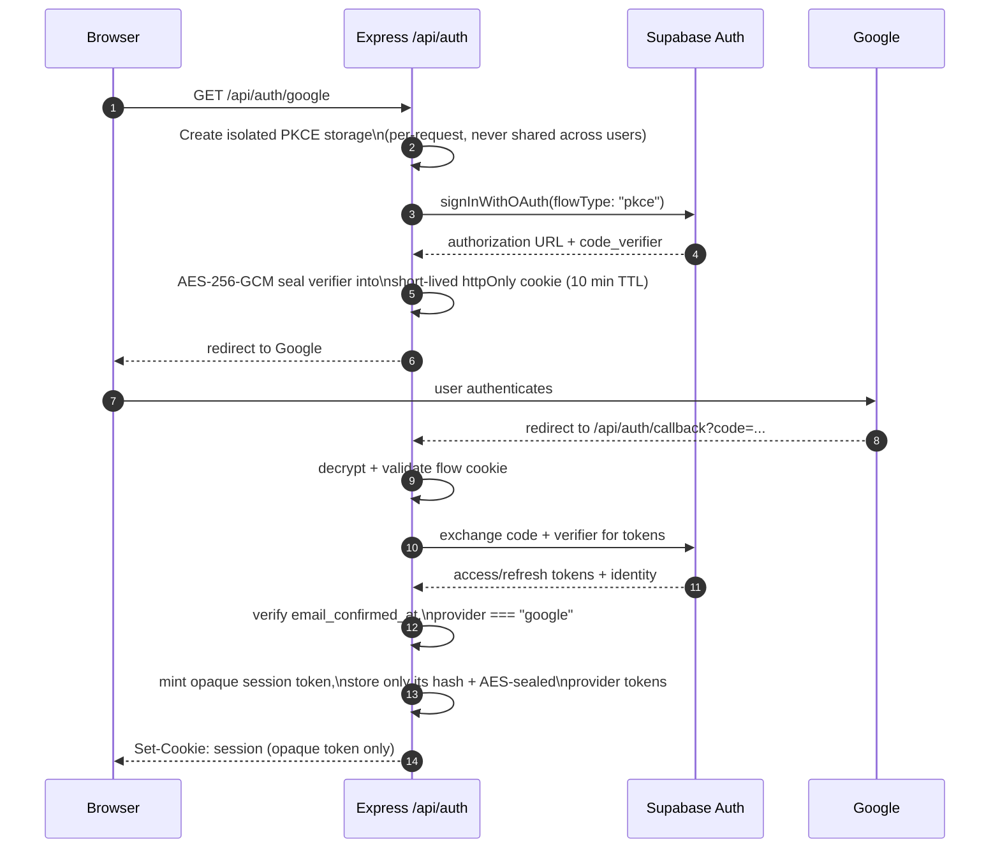

# WayDine documentation

Eat on the way, not out of the way. WayDine discovers restaurants along a driving route and explains the extra travel each stop adds. This guide describes the implementation in this repository; provider availability, database deployment and real-world road access require separate verification.

## Product and user journey

The public landing page demonstrates city and highway trips with illustrative restaurant data. Google sign-in leads to preference onboarding, then the planning form. Choose and confirm origin and destination, departure time, dietary requirements, cuisines, maximum extra driving time and an optional per-person INR budget. The results page shows route alternatives, ranked stops, arrival estimates, exclusions and uncertainty. A stop detail view supplies more information and navigation options. Profile manages defaults; History lists saved successful searches and supports deletion and replanning.

Public routes: /, /signin and /docs. Account routes: /onboarding, /plan, /trip, /trip/stop/:id, /profile and /history. The onboarding route permits accounts without saved preferences; other account pages require completed preferences.

## System architecture



Google Maps JavaScript renders the browser map separately, outside this request pipeline — it never sees recommendation data beyond what the results page passes it for display.

Frontend state lives in AuthProvider and the account-keyed TripProvider. Changing accounts remounts trip state. Pages are lazy loaded behind an error boundary. The API client handles credentials, cancellation and structured errors. Provider adapters isolate external HTTP from recommendation logic. Graph modules implement road topology independently from display rendering. PostgreSQL persists account data; restaurant discovery is provider driven rather than a curated database lookup.

### Layered design

The backend separates four concerns that are easy to tangle in a single "recommend" function, and keeping them apart is what makes the ranking logic in this guide testable in isolation:

- **Providers** (`backend/src/providers`) speak HTTP to one external service each and return typed results. Nothing here knows about ranking, eligibility or the user's preferences.
- **Services** (`backend/src/services`) contain pure(ish) domain logic — eligibility rules, hour parsing, ranking cost, routing orchestration — and are unit-tested against mocked provider output (`backend/test`).
- **Routes** (`backend/src/routes`) only validate HTTP input with Zod, call one orchestrating service function, and map the result or thrown `AppError` onto an HTTP response.
- **Graph** (`backend/src/graph`) is a self-contained road-network module (OSM parsing, snapping, Dijkstra) that the routing service calls but that has no knowledge of restaurants, preferences or HTTP at all.

This is a fairly conventional layered/hexagonal split: providers and the database are the outer "adapters," services are the application core, and routes are the inbound adapter. It is what lets `ROUTING_ENGINE` or `restaurantSource` be swapped (Google vs. graph, Google Places vs. Geoapify/Mapbox) without touching ranking or eligibility code.

## Repository map

- frontend/src/pages: public, planning, results, details and account screens.
- frontend/src/components: reusable UI, landing visuals, maps, trip panels and shell.
- frontend/src/app: authentication and trip state providers.
- frontend/src/lib: typed HTTP client, formatting, motion and provider browser integration.
- backend/src/routes: HTTP validation and endpoint orchestration.
- backend/src/services: discovery, eligibility, hours, budgets, ranking, routing, preferences and history.
- backend/src/providers: Google, Google Routes, Geoapify and retained Mapbox adapters.
- backend/src/graph: OSM parsing, directed roads, snapping, turn restrictions, shortest paths and traffic observations.
- backend/src/auth: OAuth provider, encrypted sessions, cookie and Origin checks.
- backend/src/db: account storage and optional analytics adapters.
- backend/sql: ordered database migrations; backend/test: mocked service and HTTP tests.
- docs: feature setup guides and historical audits. Older audits describe the code at their recorded time, not necessarily current behavior.

## Recommendation pipeline

A trip search is one call to `recommend()` in `backend/src/services/recommend.ts`, reached from `POST /api/recommend` (legacy/Geoapify path) or `POST /api/google/recommend` (account-aware Google path). Both routes share the same pipeline; they differ in which discovery and routing providers `ProviderContext` wires up.



1. **Validate.** Coordinates in longitude/latitude order, departure window (`now − 10 min` to `now + 14 days`), and preferences are checked with Zod plus domain rules (both points inside India, endpoints ≥150 m apart). Google requests merge saved account defaults with explicit trip overrides.
2. **Route.** Obtain route alternatives from Google Routes (or Mapbox) and select the requested baseline. If that alternative is no longer offered, fall back to the fastest and add a warning.
3. **Discover.** Find candidate venues along the route — see [Discovery and candidate search](#discovery-and-candidate-search) below for the corridor and deduplication algorithm.
4. **Filter for eligibility.** Each candidate is checked against *hard* pass/fail rules — see the exclusion table below — before any expensive routing call is spent on it.
5. **Select fairly.** `selectForScreening()` spreads the remaining screening budget across 6 buckets of the route's length (geographic "lanes"), round-robin, each bucket internally sorted by distance from the route. This stops one dense cluster of restaurants near the origin from consuming the entire per-request provider budget and starving stops near the destination.
6. **Screen, then verify.** A cheap batched estimate (Distance Matrix, ≤23 stops per batch) ranks candidates by rough added time; only the top `verifyMax = 8` (Google mode) or `graphEvalMax = 12` (graph mode) get an exact via-stop route computed and compared against the baseline.
7. **Evaluate evidence.** Dietary and cuisine evidence, price budget, opening hours at the *verified* arrival instant, meal-service fit and access confidence are all assessed per surviving candidate. Unknown information is represented explicitly (`"unknown"`, never guessed as yes/no). Arrival labels always use Asia/Kolkata, independent of server timezone.
8. **Rank.** Exclude confirmed failures (recorded with a reason, never silently dropped) and rank the rest by `rankingCostSec()` — see below. Return recommendations, exclusions, warnings, routing metadata and per-stage diagnostics (timings and counts).
9. **Persist.** For authenticated requests carrying `tripLabels`, save an account-owned summary after a successful response — including zero-result searches. A history write failure never blocks the response; it's reported as `historySaveFailed` instead.

### Hard eligibility filters vs. soft ranking penalties

The pipeline is deliberately two layers, not one: a binary gate that removes a candidate entirely, followed by a continuous cost that only orders the survivors. Conflating the two — e.g. "penalizing" a candidate that can't actually be reached — would misrepresent certainty as a mere preference, so every exclusion below is a hard stage with a stated reason, not a large penalty score.

| Stage | File | Excludes when |
|---|---|---|
| `diet` | `services/eligibility.ts` | Evidence is `"none"`; or preference is `pure-veg` but evidence is only `"options"`; or evidence is `"unknown"` and the user did not opt into `includeUnconfirmedDiet` |
| `cuisine` | `services/eligibility.ts` | None of the requested cuisine tags match the venue's listed cuisine/type |
| `budget` | `services/budget.ts` | Google's listed price range starts above the per-person INR budget (compared as integer nanos via `BigInt`, to avoid floating-point rounding at currency boundaries) |
| `hours` | `services/hours.ts` | Closed at the estimated arrival instant — checked twice: a cheap ±20-minute pre-check before routing, then an exact check at the verified arrival time |
| `meal` | `services/meal.ts` | The venue's listed meal-service flags (breakfast/lunch/dinner/dessert/coffee) explicitly say `false` for the arriving meal period — only an explicit "no" excludes, never missing data |
| `detour` | `services/recommend.ts` | Estimated or exact extra time exceeds `maxDetourMinutes × 60` seconds, or graph routing finds ≥1000 m of backward travel near the stop |
| `unreachable` | routing providers | No route could be found to the stop at all |
| `verification` | routing providers | A routing/quota failure occurred during the expensive verification step |

Everything that survives every stage gets a **ranking cost**, computed by `rankingCostSec()` in `services/ranking.ts`:

```
cost = max(0, extraTimeSec)
     + 180  if hours === "unknown"
     + 300  if closesWithinMinutes !== null && closesWithinMinutes <= 30
     + 120  if accessConfidence === "uncertain"
     + 240  if diet !== "any" && vegetarian === "unknown"
     + 90   if possibleAdditionalUTurn
     + 120  if possibleBackwardTravel
```

| Penalty | Seconds | Fires when |
|---|---|---|
| `hoursUnknown` | 180 | No opening-hours evidence exists at all for the stop |
| `closesWithin30Min` | 300 | Listed closing time is within 30 minutes of the verified arrival |
| `accessUncertain` | 120 | The routing snap distance exceeds the "good"-confidence threshold (35 m for a listing coordinate, 50 m for a provider access point or a graph route) |
| `dietUnconfirmed` | 240 | The user set a diet preference but vegetarian status is `"unknown"` (only reachable when `includeUnconfirmedDiet` let it survive the hard filter above) |
| `possibleAdditionalUTurn` | 90 | The router reports a U-turn that the baseline route doesn't have |
| `possibleBackwardTravel` | 120 | Route-evidence assessment flags possible backward travel near the stop that didn't reach the 1000 m hard-exclusion threshold |

Every penalty is denominated in **equivalent seconds of driving** and added straight onto the real detour time — there is no separate 0–100 "match score," and the source code says why: *"No percentage or 'match' score is produced: there is no calibrated quality signal (neither data source supplies ratings or reviews), so none is implied"* (`services/ranking.ts`). The six constants are hand-picked, documented ordering weights, not measured user preferences, learned weights or calibrated confidence intervals, and they never change the *displayed* detour time — only the sort order. Candidates are sorted ascending by this cost, with ties broken first by raw `extraTimeSec`, then by straight-line distance from the route, then by id, so the ordering is fully deterministic.

## Discovery and candidate search

Finding candidate venues is handled by one of two independent strategies, selected by `ProviderContext.restaurantSource` (`backend/src/providers/context.ts`): **Google mode** (current default for authenticated use) and the **legacy corridor search** (Geoapify + Mapbox, kept for the non-account `/api/recommend` path and as a provider-independent fallback).



**Google mode** (`services/googleDiscovery.ts`) sends Places **Text Search (New)** the route's own encoded polyline as a `searchAlongRouteParameters` bias, so Google does the along-route sampling itself rather than WayDine issuing many circular searches. Results are paginated up to `GOOGLE_MAX_PAGES = 3` (Google's API ceiling is 20 results/page, 60 total), and permanently/temporarily closed venues are filtered out before anything downstream sees them.

**Legacy mode** (`services/discovery.ts`) lays the route into a bounded number of circular search areas (`maxInitialAreas = 10`) and queries both providers per area through a small worker-pool limiter (`mapSettled`, concurrency 4 — not `Promise.all`, so at most 4 provider requests are ever in flight together). If a provider's response page comes back "full" (more results likely exist), that area gets a *bounded* follow-up rather than unlimited recursion: Geoapify is asked for up to 6 more pages, Mapbox has its bounding box quartered and the quadrants searched within a shared refinement budget. This is explicitly a budgeted drill-down, not an exhaustive search — if the refinement budget runs out, the gap is surfaced to the user as a warning rather than hidden. A single provider failing in one area does not fail the whole search; only a *total* failure (no provider succeeded anywhere) does.

**Deduplication** (`services/merge.ts`, `mergeVenues`) merges two records from different providers when **both**: they are within `SAME_PLACE_MAX_M = 75` metres of each other, **and** their names are similar — either the **Sørensen–Dice coefficient over character bigrams** is ≥ 0.85, or one name's token set is a subset of the other's. Sørensen–Dice over bigrams is a standard, cheap string-similarity metric (twice the number of shared bigrams divided by the total bigram count of both strings); the 0.85 threshold is deliberately conservative so that two branches of the same chain a few hundred metres apart are kept as separate candidates rather than collapsed into one. When two merging records disagree on dietary evidence, the merged result is explicitly reset to `"unknown"` rather than guessing — contradictory evidence is not evidence. `mergeVenues()` itself is a naive O(n²) scan (each new venue checked against every already-merged entry, no spatial index); this is a deliberate simplicity-over-scale tradeoff that's only correct because the corridor search above already bounds candidate counts to the low hundreds per request.

**Corridor filtering**: every surviving venue's perpendicular distance to the route polyline is computed and anything beyond the corridor half-width is dropped. That half-width is itself derived from the user's detour budget, not a fixed constant: `clamp(maxDetourMinutes × 100 m, 300 m, 1500 m)` — the reasoning recorded in code is that "a there-and-back diversion of 100 m per minute of detour budget is already optimistic," so a 10-minute detour budget corresponds to a ~1000 m corridor half-width either side of the route.

**Caching**: Geoapify responses are cached in-process (`TtlCache`, 6-hour TTL, 2000-entry cap) because, per the code comment, "its terms do not restrict caching." Google and Mapbox responses are not cached this way — consistent with this project's rule that Google Places calls stay deliberate and bounded rather than implicitly reused across unrelated requests.

## Graph routing and limitations

`ROUTING_ENGINE=google` is the default — Google Routes supplies both the baseline route and per-stop detour estimates. `ROUTING_ENGINE=graph` instead ranks candidate stops using a **directed Dijkstra shortest-path search over OSM road data**, built from scratch in `backend/src/graph` (no routing library), while still using Google for the discovery corridor and bounded cross-checks. `OSM_GRAPH_SOURCE=file` reads a pre-extracted `OSM_GRAPH_PATH`; `OSM_GRAPH_SOURCE=overpass` downloads corridor road data on demand and caches it under `GRAPH_CACHE_DIR`. File mode needs coverage of the complete journey and any detours actually taken.

### Why Dijkstra needs an augmented state, not just a node

A plain Dijkstra search tracks "cheapest cost to reach node N." This graph adds two requirements that a bare node-keyed search can't express, so each search state in `graph/shortestPath.ts` is `{ node, previous, way, visited }`, not just `node`:

- **Turn restrictions** depend on *how* you arrived, not just *where* you are — an OSM `no_left_turn` restriction only applies when leaving a specific incoming way. Carrying `way` (the OSM way currently being traveled) in the state lets `permitted()` check the correct restriction relation at each junction before an edge is relaxed.
- **A mandatory waypoint** ("route through this candidate stop") needs the search to distinguish "at the stop, continuing" from "at the stop, done." Carrying a `visited` flag means a *single* Dijkstra run computes the shortest *origin → stop → destination* path directly — the destination is only accepted as final once `visited` is true — instead of running two separate searches (origin→stop, then stop→destination) and gluing the results together.



The priority queue is a hand-rolled binary min-heap (array-backed, `O(log n)` push/pop) — standard textbook Dijkstra complexity applies to the augmented state graph: with `V` distinct `(node, way, visited)` states and `E` edges reachable from them, the search is **O((V + E) log V)**. In practice the `way` and `visited` dimensions only multiply the state space by a small constant (the node's distinct incoming ways, times 2 for the visited flag), so this stays close to ordinary single-source Dijkstra on the same road network.

**Edge weight** is travel time in seconds: either a live traffic observation (if supplied and still fresh) or `distanceM / (speedKmh / 3.6)` using a fixed per-road-class speed table (motorway 80 km/h down to living_street 10 km/h — deliberately conservative defaults, not a traffic forecast).

**Detour computation** runs the same Dijkstra twice over the identical graph and weights — once origin→destination directly, once origin→stop→destination via the mandatory-waypoint state — and subtracts: `extraSeconds = max(0, viaSeconds − baselineSeconds)`. Because both legs share the same graph, weight model and restrictions, the subtraction is apples-to-apples rather than comparing two differently-estimated numbers.

### Building and fetching the graph



OSM data acquisition uses the Overpass API's `around:` query — a buffer of `1500 m` around the route's own (simplified) polyline, not a bounding box, so a long highway leg doesn't needlessly expand the query area sideways. The query polyline is itself simplified (a Douglas–Peucker-style line simplification with increasing tolerance) down to at most 60 points to keep the Overpass query compact. Three public Overpass mirrors are tried in order; responses are capped at 30 MB / 200,000 nodes, and `MAX_TRIP_METRES = 200 km` bounds how long a route can be before on-demand graph loading is attempted at all.

Fetched graphs are cached two ways: a small in-memory `Map` (bounded to 3 graphs, oldest evicted first) for immediate reuse within a server process, and a disk cache keyed by the SHA-256 hash of the Overpass query, so identical corridors are never re-downloaded. Concurrent identical requests share one in-flight fetch (rather than issuing the same Overpass query twice), and *all* Overpass fetches from this process are serialized through a single queue — public Overpass servers expect one heavy request at a time from a given client, not a burst.

**Snapping**: `snapToRoad()` projects a query point onto every candidate edge's line segment and keeps the closest one within a maximum distance. If the closest point falls strictly inside a segment (not at an existing node), the function *splits that edge*, inserting a synthetic node and two new partial edges with proportionally scaled distance/time — this is real graph surgery to get an accurate snap point, not a "nearest existing node" approximation. Restaurant snapping excludes motorway/motorway-link edges and is bounded to 75 m; an `ambiguous` flag is set when a second-best match is within 5 m of the best one.

**Coverage guard**: before routing, up to 60 points sampled along the Google baseline route are checked against the fetched extract's bounding box; if fewer than 95% fall inside it, the request is rejected with `OUT_OF_COVERAGE` and the caller falls back to Google rather than silently routing on an incomplete map.

**Reconciling two time models**: because the graph's own speed table is a rough per-class estimate, its baseline duration is linearly rescaled to match Google's duration for the same baseline route — `graphScale = clamp(googleDurationSec / graphDurationSec, 0.4, 2.5)` — and every graph-derived "extra time" is multiplied by this factor before being shown as real minutes. This keeps the graph engine's numbers anchored to a live, calibrated source rather than drifting from the static speed table alone.

**U-turns and backward travel** are evidence signals distinct from detour time. A U-turn is detected when the router reports reversing direction on the same edge at a junction that had another option (dead ends and the stop itself are excluded from the count) and feeds the `possibleAdditionalUTurn` ranking penalty. Backward travel is assessed by comparing the via-route geometry against the baseline geometry; **at or beyond 1000 m of backward travel a stop is excluded outright** (a hard filter, not a penalty — see the ranking section above), while smaller amounts only feed the `possibleBackwardTravel` penalty.

**Cross-checking**: in graph mode, the top-ranked results (up to `crossCheckTop`) are additionally re-verified against real Google Directions; a disagreement beyond `max(180s, 50% of the larger value)` is surfaced as an uncertainty flag but — by design — "its failure never changes the ranking." Cross-checking adds confidence information without feeding back into the sort order.

If graph preparation fails for any reason (missing extract, coverage failure, no path found), the whole request falls back to Google routing for that search and exposes `routing.fallbackReason` to the client rather than failing the request. `POST /api/graph/route` is a separate, independent graph preview endpoint for inspecting routing behavior directly; its Overpass requests are limited to a 200 km corridor and may omit paths outside it. A missing graph path never establishes real-world inaccessibility — OSM coverage, snapping accuracy, access restrictions and turn-restriction coverage can all be incomplete. OpenStreetMap attribution is preserved wherever graph-derived data is shown.

Traffic observation support (`graph/traffic.ts`) accepts fresh, direction-specific adapter input and falls back to the static per-class speed estimate for stale or absent observations — but no live traffic feed is wired up by default in this repository, so in practice the fallback path is what currently runs. This is a planning estimate, not turn-by-turn navigation or a traffic forecast.

## API reference

All paths below are relative to the backend origin. Request and response types are defined in backend/src/contract/api.ts. Google account mutations require trusted Origin and credentialed cookies; Google recommendation and detail/photo routes require enabled Places and authentication.

```text
GET    /api/health                    Process liveness
GET    /api/ready                     Configuration readiness
GET    /api/auth/status               Sign-in configuration status
GET    /api/auth/google               Start Google OAuth redirect
GET    /api/auth/callback             Complete PKCE code exchange
GET    /api/auth/me                   Current public account
POST   /api/auth/logout               Revoke session (trusted Origin)
GET    /api/me/preferences            Account defaults and saved state
PATCH  /api/me/preferences            Partial preference update
DELETE /api/me/preferences            Reset defaults
GET    /api/me/trips                  Owner history; limit and cursor
DELETE /api/me/trips/:id              Delete owner's summary
DELETE /api/me/trips                  Clear owner's history
GET    /api/places/suggest            Location autocomplete
GET    /api/places/reverse            Coordinate lookup
POST   /api/recommend                Legacy discovery recommendation
GET    /api/google/status             Google Places configuration
POST   /api/google/recommend          Account-aware recommendations
GET    /api/google/restaurants/:placeId  Bounded details
GET    /api/google/photo              Bounded photo retrieval
POST   /api/graph/route               Independent OSM graph preview
```

Example authenticated Google request body (documentation only; submitting it calls providers):

```json
{
  "source": [72.85, 19.20],
  "destination": [72.86, 19.23],
  "departure": { "mode": "now" },
  "preferences": {
    "diet": "vegetarian-options",
    "includeUnconfirmedDiet": false,
    "maxDetourMinutes": 10,
    "cuisines": [],
    "budgetPerPersonInr": 500
  },
  "tripLabels": { "source": "Origin", "destination": "Destination" }
}
```

Google preferences are optional partial overrides. Legacy recommendation requests require their complete preference object and do not use account history. History uses newest-first keyset pagination, default 20 and maximum 50 records; nextCursor is nullable. Replanning restores labels and preferences, resets departure, and requires endpoint confirmation without automatically calling Places.

Errors use an error object with code, message and optional requestId, retryAfterSec and details. Important statuses: BAD_REQUEST 400, UNAUTHENTICATED/AUTH_FAILED 401, FORBIDDEN 403, NO_ROUTE/OUT_OF_COVERAGE 422, RATE_LIMITED/QUOTA_EXCEEDED 429, UPSTREAM_UNAVAILABLE 502, NOT_CONFIGURED 503 and UPSTREAM_TIMEOUT 504. Provider bodies and tokens are not exposed as client diagnostics.

## Database and migrations

001_schema.sql creates PostGIS restaurant/opening-hour tables and search_history. The restaurant tables, 002_candidates_rpc.sql and 003_seed.sql belong to the earlier curated-data design; current provider discovery does not require seeded restaurants. The optional analytics logger uses search_history.

Apply 004_google_auth.sql, then 005_user_preferences.sql, then 006_trip_history.sql for account features. They create profiles, auth_sessions, user_preferences and account-owned trip history with indexes, policies and service-controlled writes. Apply SQL separately in Supabase; application startup does not migrate remote databases. Check each migration's prerequisites before running it.

Profiles reference Supabase identity; sessions store hashes of opaque identifiers and encrypted provider token envelopes. Preferences store account defaults. Trip summaries retain labels, timestamps, effective preferences, result count and an account-scoped idempotency identifier. They do not retain coordinates, restaurant records, route geometry, photos or tokens. Deleting a profile cascades to its history. Optional search analytics are separate and can store coordinates: review their retention before enabling SEARCH_LOGGING.

## Local development

Install dependencies separately in backend and frontend. Copy each .env.example to .env and configure only the capabilities needed. Never commit keys. Use a Node version compatible with the installed Vite release and the lockfiles.

```sh
# Terminal 1, from backend/
npm ci
npm run dev
# Terminal 2, from frontend/
npm ci
npm run dev
```

The API defaults to localhost:4000 and Vite to localhost:5173. Vite proxies /api to the backend; WAYDINE_API_PROXY changes the development/preview proxy target. VITE_API_BASE_URL changes the browser API base. /docs remains public without signing in. A provider-free install can render documentation and the illustrative landing page; real recommendations need configured providers.

## Configuration and provider boundaries

- Google Maps display: VITE_GOOGLE_MAPS_API_KEY, restricted to browser referrers and Maps JavaScript. Map loads have separate billing; documentation itself contains no map.
- Route computation: GOOGLE_ROUTES_API_KEY, GOOGLE_ROUTES_PER_DAY (100 default), GOOGLE_ROUTE_MATRIX_ELEMENTS_PER_DAY (300 default). Both limits accept null or none to disable the application ceiling. GOOGLE_RECOMMEND_PER_MINUTE (2 default) controls the Google recommendation request rate and also accepts null or none.
- Restaurant discovery: GOOGLE_PLACES_ENABLED=false by default and GOOGLE_PLACES_API_KEY. Enable explicitly after configuring auth. Default per-request limits are 3 searches and 3 details, with a 200 m corridor. Daily/monthly nearby limits are 20/100, details 20/100 and photos 30/200. These are application ceilings, not promises about provider pricing or free allowances.
- Search: GEOAPIFY_API_KEY powers existing location search and legacy discovery. Mapbox adapters and budget configuration remain for legacy paths; they do not render the current Google map.
- Account storage: SUPABASE_URL, SUPABASE_PUBLISHABLE_KEY and server-only SUPABASE_SERVICE_ROLE_KEY. AUTH_ENABLED=true also requires AUTH_ENCRYPTION_KEY, a base64 32-byte key. Configure AUTH_CALLBACK_URL, AUTH_FRONTEND_URL, CORS_ORIGIN and AUTH_COOKIE_SECURE.
- Runtime controls: PORT, TRUST_PROXY, SEARCH_LOGGING, QUOTA_STATE_FILE and GOOGLE_PLACES_QUOTA_FILE. Full validated configuration and defaults live in backend/src/config.ts; both .env.example files describe deployment values.

Before any live Google Places API request, obtain explicit approval for that request or a clearly bounded batch. A configured key is not authorization. Automated tests must mock Google, including photos. Do not automatically run backend/scripts/test-live-apis.mjs or Google-backed smoke searches.

## Rate limiting and quota management

Two different, purpose-built algorithms protect the system — one bounds how many requests a *client* can make, the other bounds how much *upstream provider* budget the whole server spends. They are easy to conflate but are genuinely different data structures, both defined in `backend/src/lib/quota.ts`.

### `QuotaManager` — fixed-window counter (protects provider budgets)

This is a classic **fixed-window counter**, not a token bucket or a sliding window. For a named budget bucket (e.g. `google_places_nearby`, `mapbox_matrix_elements`) it tracks a cumulative `used` count against a `limits` ceiling for the current period (day or month, keyed to the **Asia/Kolkata** calendar so the reset always lands at IST midnight regardless of server timezone):



Budget is **reserved before the call is made, not after it succeeds** — the file's own comment states the reasoning directly: *"usage is reserved before each upstream call (failed calls still count)."* This is a deliberately conservative choice: it undercounts available budget in exchange for never letting a burst of retried failures spend more than the configured ceiling. State persists to a JSON file (debounced 250 ms, written to a temp file and atomically renamed) — this is exactly the `backend/.data/quota-state.json` file tracked in this repository. Two independent `QuotaManager` instances run per request context: a **daily** one and a **monthly** one, since Google's own billing ceilings are monthly while the app's own defaults are daily. A `null` limit means "track usage but never deny" — useful for observing real consumption before choosing a ceiling.

### `ClientRateLimiter` — sliding-window log (protects the API from abuse)

This one genuinely **is** a sliding-window algorithm — a sliding-window *log*, specifically: for each client key (by IP), an array of hit timestamps is kept, filtered down to the last 60,000 ms on every check:

```
recentHits = hits[clientKey].filter(t => t > now - 60_000)
if recentHits.length >= perMinute: reject, retryAfterSec = ceil((recentHits[0] + 60_000 - now) / 1000)
else: recentHits.push(now); allow
```

Because the window slides continuously (rather than resetting at fixed minute boundaries like the quota counter above), a client can never get two full quotas' worth of requests by timing a burst across a window edge — the classic failure mode of fixed-window limiters. The tracked-client map is bounded to 10,000 keys with oldest-first eviction, so a flood of distinct IPs can't grow it unboundedly. `/api/recommend` and the trip-history mutation routes each get their own `ClientRateLimiter` instance.

### Retry and backoff

`lib/http.ts`'s `fetchJson` wraps every upstream call with: a per-attempt timeout (`AbortSignal.timeout`, default 8000 ms, combined with the caller's own cancellation signal), up to 2 additional retries on a defined retryable-status set (`429, 500, 502, 503, 504`), and **exponential backoff with jitter** between attempts:

```
delayMs = 250 × 2^attempt + random(0, 100)
```

A `Retry-After` response header, when present, is honored instead (capped at 2000 ms). Quota is reserved on *every* attempt, not just the first, consistent with the "failed calls still count" policy above — a provider that fails twice and succeeds on the third attempt is billed for three units of budget, matching what actually happened against the real API.

## Authentication and security

Google redirects through Supabase OAuth to the fixed backend callback, using the **PKCE (Proof Key for Code Exchange)** flow rather than the older implicit flow — appropriate here since the OAuth code exchange happens on the backend, not directly in the browser.



PKCE flow state is encrypted in a short-lived cookie using a **per-request, isolated in-memory storage object** rather than the SDK's default shared storage — this specifically prevents one user's in-flight PKCE verifier from leaking into another concurrent user's exchange on the same server process. Provider tokens remain encrypted server side with purpose-bound AES-256-GCM. Sessions use opaque random identifiers whose **hashes** are persisted (never the token itself) — a database read alone can't reconstruct a usable session token. Browser JavaScript receives public identity rather than provider tokens, and an access token nearing expiry (within 60 seconds) is refreshed lazily on the next authenticated request, with in-flight refreshes for the same session de-duplicated to avoid a refresh-token rotation race between concurrent requests. Logout deletes the local session row *before* attempting to revoke it upstream, so logout stays effective for this server even during a provider outage.

Production requires HTTPS, AUTH_COOKIE_SECURE=true, exact allowed redirects and same-site frontend/API hosts or an /api reverse proxy. Secure cookies use the __Host- prefix, HttpOnly and SameSite=Lax. Sensitive responses use no-store. Trusted-Origin checks protect account mutations. Owner IDs come from authenticated sessions rather than request bodies. Service-role credentials stay on the server; validate RLS and grants with real separate accounts after migrations.

Keep AUTH_ENCRYPTION_KEY stable across restarts; rotation invalidates existing encrypted sessions. Never expose backend keys through VITE_ variables. Trust proxy headers only behind a controlled reverse proxy. IP rate limits and refresh coordination are process local: multiple replicas need shared coordination and quota storage rather than relying on independent local files.

## Frontend and motion

The UI uses React Router, Tailwind and Radix-based components, Lucide icons and shared TypeScript contracts. GSAP handles entrance effects; Lenis connects scrolling to ScrollTrigger. The landing hero uses Vanta NET with Three.js, desktop and reduced-motion gating, and graceful WebGL failure. Documentation reuses the visual language with readable sections, search and anchors. PWA runtime caching is empty and /api is excluded from navigation fallback to avoid serving the app shell for API requests.

## Tests and verification

```sh
# backend/
npm run typecheck
npm test
npm run build
# frontend/
npm run lint
npx vitest run
npm run build
```

Backend tests cover HTTP validation, mocked providers, quotas, route evidence, graph behavior, opening hours, meal timing, budgets, auth, preferences and trip history. Frontend tests cover recommendation contract handling and history interactions. Tests do not establish production RLS correctness, provider uptime, billing, map accuracy or navigation safety. Historical live-test files record bounded prior runs and are not performance benchmarks.

## Deployment and troubleshooting

Build backend to dist and run npm start. Publish frontend/dist on an SPA-capable host that rewrites non-file paths such as /docs to index.html; keep /api routed to Express. Configure TLS, same-site cookies, exact CORS origins, environment variables, database migrations and persistent storage for quota/cache files. Keep secrets and .data outside public static hosting. Vite preview is for verification rather than the production server.

NOT_CONFIGURED means a capability is disabled or missing required configuration. A blank map usually needs a browser key, API enablement or referrer configuration. Auth callback failures require matching Google→Supabase and Supabase→backend redirects. Preference/history failures can indicate unapplied migrations. Graph fallback needs extract coverage and usable endpoint snaps; inspect fallbackReason. Quota errors require reviewing local counters and provider dashboards rather than blindly retrying. Use request IDs to correlate sanitized server logs.

## Algorithm summary

A single reference table for every algorithm named in this guide, each with its asymptotic complexity where one meaningfully applies and the file it lives in. "No library" means it is a from-scratch implementation in this repository, not a wrapped npm package.

| Algorithm | Type | Complexity | Where |
|---|---|---|---|
| Graph shortest path | Augmented-state Dijkstra, hand-rolled binary min-heap, no library | O((V + E) log V) over the `{node, way, visited}` state space | `graph/shortestPath.ts` |
| Route polyline simplification | Douglas–Peucker-style simplification, increasing tolerance | O(n log n) typical, O(n²) worst case per pass | `lib/geo.ts`, called from `graph/tripGraph.ts` |
| Road-point snapping | Linear scan + point-to-segment projection, with edge-splitting on an interior hit | O(E) per snap query | `graph/snap.ts` |
| Venue deduplication | Sørensen–Dice coefficient over character bigrams + token-subset check | O(n²) — each venue is compared against every already-merged entry, no spatial bucketing | `services/merge.ts` |
| Candidate ranking | Deterministic multi-key sort (cost, then 3 tiebreakers) | O(n log n) | `services/ranking.ts` |
| Fair candidate selection | Round-robin bucket sampling (6 geographic lanes) | O(n log n) (dominated by per-lane sort) | `services/recommend.ts` (`selectForScreening`) |
| Provider quota tracking | Fixed-window counter, IST day/month keyed | O(1) per check | `lib/quota.ts` (`QuotaManager`) |
| API abuse protection | Sliding-window log, per client key | O(k) per check, k = requests in the trailing 60s window | `lib/quota.ts` (`ClientRateLimiter`) |
| Upstream retry | Exponential backoff with jitter | — | `lib/http.ts` |
| Discovery search-area refinement | Bounded quadtree-style recursive bbox splitting (Mapbox) / extra pagination (Geoapify) | Bounded by `maxMapboxRefinements`/`maxGeoapifyExtraPages`, not exhaustive | `services/discovery.ts` |
| Corridor filtering | Point-to-polyline perpendicular distance | O(n) per candidate against the route's point list | `services/discovery.ts`, `services/merge.ts` |
| Opening-hours evaluation | Interval containment over minute-of-week integers, with explicit overnight wraparound | O(k), k = weekly opening intervals | `services/hours.ts` |

## Further reading

Repository guides: docs/GOOGLE_AUTH.md, docs/GOOGLE_PLACES.md, docs/USER_PREFERENCES.md and docs/TRIP_HISTORY.md. PRODUCT.md explains product intent; WayDine-Build-Plan.pdf records the original plan. Source and current tests take precedence over historical planning or audit documents where they differ.

